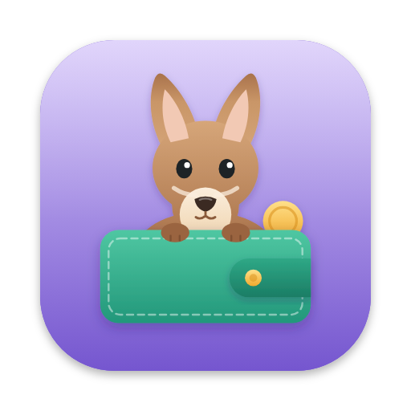

<p align="center">
  
</p>

<h1 align="center">Wallaby</h1>

<p align="center">
  Split expenses, not relationships.<br>
  A wallaby that keeps the shared wallet in its pouch.
</p>

<p align="center">
  <a href="https://wallaby.kimiyu.ch"><b>Open Wallaby</b></a>
</p>

---

Wallaby keeps a running tab for couples and housemates. Two people share a space (one creates it, the other joins with an invite code), add what they paid, one-time or recurring, and see who owes whom. Shared expenses are split 50/50; an expense paid for the partner counts 100% to them. At the end of the month you settle up, the month locks, and both get an email.

A Laravel 13 app with Livewire 3 (Volt), Tailwind CSS 4, Alpine.js and SQLite.

## Local development

The site runs in [Herd](https://herd.laravel.com) at `https://wallaby.web.test`.

```sh
composer install
npm install
cp .env.example .env && php artisan key:generate
touch database/database.sqlite && php artisan migrate
npm run dev           # or: npm run build
```

`php artisan app:setup-demo` creates two demo users (`peter@demo.com` and `maria@demo.com`, password `password`) in a shared "Demo Household" with six months of expenses. It **empties the users, spaces and expenses tables first**, so never run it against real data.

## Deploying

```sh
npm run build     # if you changed the design; commit public/build
./deploy.sh
```

`deploy.sh` runs the tests, exports the committed code, installs production dependencies, syncs it to Hostpoint over SSH with your own key and runs the migrations. The server's `.env`, the SQLite database and `storage/` (including the nightly backups in `storage/backups`) are left alone. The site runs on PHP 8.4, set in the first line of `public/.htaccess`.

## Tests

```sh
./vendor/bin/pest            # or: ./vendor/bin/pest --parallel
./vendor/bin/pint            # code style
```

The suite covers the balance calculation (equal and unequal splits, personal expenses, rounding), the models, the expense form, the expenses page with settlements, and the auth flows.

## Where things are

| | |
|---|---|
| `resources/views/welcome.blade.php` | The landing page |
| `resources/views/components/landing/app-preview.blade.php` | The expenses screen mock in the hero |
| `app/Livewire/Expenses.php` | The monthly expenses screen, balance and settling |
| `app/Livewire/ExpenseForm.php` | Adding and editing an expense |
| `app/Services/BalanceCalculator.php` | Who owes whom |
| `resources/css/app.css` | Theme colors (`lilac` for the brand, `mint` for settled, `gold` for highlights) and fonts |
| `resources/views/og-image.blade.php` | The link preview image. Run `./scripts/og-image.sh` (needs Herd and `npm run build`) to render it to `public/images/og.png` |
| `scripts/make-icon.mjs` | The icon and mascot. Edit the SVG there and run `node scripts/make-icon.mjs` to render the favicons, app icons, `public/mascot.svg`, `public/mail-logo.png` and `docs/icon.png` |

## License

MIT
